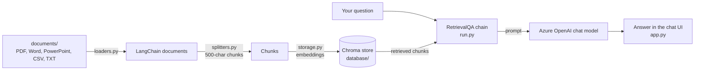

# DocGPT

Ask questions about your own documents using GPT models.

DocGPT reads the files in a folder, splits them into chunks, indexes the chunks in a local [Chroma](https://www.trychroma.com/) vector store, and answers questions with a [LangChain](https://github.com/langchain-ai/langchain) retrieval QA chain. You can use it through a Streamlit chat app or through the Jupyter notebooks in this repository.

> [!NOTE]
> DocGPT was built in mid-2023 against pinned library versions (LangChain 0.0.228, `openai` 0.27.8, Chroma 0.3.x, Streamlit 1.25). The setup below reproduces that environment; newer versions of these libraries are not compatible with the code as written.

## Contents

- [How it works](#how-it-works)
- [Supported file types](#supported-file-types)
- [Requirements](#requirements)
- [Installation](#installation)
- [Configuration](#configuration)
- [Usage](#usage)
- [Notebooks](#notebooks)
- [Project structure](#project-structure)
- [Known limitations](#known-limitations)
- [Troubleshooting](#troubleshooting)
- [License](#license)

## How it works



1. **Load** – every supported file in `DOCUMENTS_DIR` is opened with the LangChain loader that matches its extension (`docgpt/loaders.py`).
2. **Split** – documents are cut into chunks of up to 500 characters with a 50-character overlap using `RecursiveCharacterTextSplitter` (`docgpt/splitters.py`).
3. **Index** – any existing store in `VECTORSTORE_DB_DIR` is deleted and a new Chroma store is built from the chunks (`docgpt/storage.py`). The app does this once, when its first page loads. Chunks are embedded with OpenAI embeddings when an API key is configured, otherwise with a local Hugging Face sentence-transformers model.
4. **Answer** – a `RetrievalQA` chain picks the chunks most relevant to your question (5 by default, set by `TARGET_SOURCES`), skipping near-duplicates, and sends them with the question to the chat model (temperature 0.7) in a single prompt (the `"stuff"` strategy), then returns its answer (`docgpt/run.py`, with retrieval in `docgpt/retrieval.py`). The Streamlit app (`docgpt/app.py`) shows the conversation.

## Supported file types

| Extension | Loader | Notes |
| --- | --- | --- |
| `.pdf` | `PyMuPDFLoader` | One document per page. |
| `.docx` | `UnstructuredWordDocumentLoader` | |
| `.doc` | `UnstructuredWordDocumentLoader` | Requires [LibreOffice](https://www.libreoffice.org/) (`soffice` on your `PATH`) to convert the file first. |
| `.pptx` | `UnstructuredPowerPointLoader` | |
| `.csv` | `CSVLoader` | One document per row. |
| `.txt` | `TextLoader` | Read as UTF-8. |

Rules for the documents folder:

- Extensions are matched in any letter case (`report.PDF` works).
- Files with other extensions are skipped, and a `Skipping unsupported file` message is printed in the terminal.
- Hidden files (names starting with `.`, such as `.DS_Store`) and subfolders are skipped. Subfolders are not scanned.
- `documents/` is listed in `.gitignore`, so files you add there are not committed (the sample `documents/bitcoin.pdf` was committed before that rule was added).

## Requirements

- **Python 3.10.** The pinned dependencies include packages that don't install on Python 3.11 or later (for example `wrapt` 1.13.3, required by `argilla` 1.1.1).
- **A C++ compiler.** Chroma 0.3.x depends on `hnswlib`, which is only published as source and is compiled during installation: `build-essential` on Linux, Xcode Command Line Tools on macOS, or Microsoft C++ Build Tools on Windows.
- **An Azure OpenAI resource** (for the Streamlit app and the OpenAI notebooks) with:
  - a chat model deployment, for example GPT-4 32k;
  - an embeddings deployment, for example of the `text-embedding-ada-002` model.
- **Internet access on first run.** The `unstructured` library downloads NLTK data the first time it loads a Word or PowerPoint file, and the local-model notebooks download their embeddings model from Hugging Face.
- Optional: **LibreOffice** to load `.doc` files, and a **GPT4All model file** for the local-model notebooks (see [Notebooks](#notebooks)).

## Installation

```bash
git clone https://github.com/gitluis/docgpt.git
cd docgpt

# Create and activate a Python 3.10 environment
python3.10 -m venv .venv
source .venv/bin/activate            # Windows: .venv\Scripts\activate
```

Then install the pinned dependencies:

```bash
pip install -r pip-requirements.txt
```

`pip-requirements.txt` pins every package to the versions the project was developed with (mid-2023), on Linux, macOS and Windows. It includes `torch`, so the download is large: several GB on Linux, where torch brings its CUDA libraries.

Chroma is pinned to `0.3.26` on purpose: Chroma 0.4 and later dropped the `duckdb+parquet` storage the code uses. Don't upgrade it.

If you use conda, create the environment with `conda create -n docgpt python=3.10`, activate it, and run the same `pip install` command.

## Configuration

Settings are read from a `.env` file with [python-dotenv](https://github.com/theskumar/python-dotenv). Start from the annotated template:

```bash
cp env-example.txt .env
```

Keep `.env` in the repository root. It is listed in `.gitignore`; never commit API keys.

### Streamlit app and OpenAI notebooks

The required `OPENAI_*` values are passed straight to the `openai` client, so a missing or empty value causes an error. These names follow the Azure OpenAI setup the code was written for.

| Variable | Required | Description |
| --- | --- | --- |
| `DOCUMENTS_DIR` | Yes | Folder with the files to index, relative to where you start the app. Default in the template: `documents`. |
| `VECTORSTORE_DB_DIR` | Yes | Folder for the Chroma store. Default in the template: `database`. If it already contains a Chroma store, the **whole folder is deleted** and rebuilt each time the index is built, so don't keep other files in it. |
| `OPENAI_API_TYPE` | Yes | `azure`. |
| `OPENAI_API_BASE` | Yes | Your resource endpoint, for example `https://<resource-name>.openai.azure.com/`. |
| `OPENAI_API_VERSION` | Yes | An Azure OpenAI REST API version your resource supports. |
| `OPENAI_API_KEY` | Yes | Your Azure OpenAI key. |
| `OPENAI_API_DEPLOYMENT_NAME` | Yes | Name of your chat model deployment. |
| `OPENAI_API_MODEL_NAME` | Yes | The model behind that deployment, for example `gpt-4-32k`. |
| `OPENAI_EMBEDDINGS_MODEL_NAME` | Yes | The embeddings model, for example `text-embedding-ada-002`. |
| `OPENAI_EMBEDDINGS_DEPLOYMENT_NAME` | No | Name of your embeddings deployment. Defaults to `OPENAI_EMBEDDINGS_MODEL_NAME`, so you can leave it empty when the deployment is named after the model. |
| `TARGET_SOURCES` | No | Number of chunks retrieved and sent to the model with each question. Default: 5. Set it to `all` to send every chunk, which helps with questions about all of your documents (such as summaries) but only works if their combined text fits in the model's context window. |
| `RETRIEVER_SEARCH_TYPE` | No | How those chunks are picked. `mmr` (default, maximal marginal relevance) looks at the 20 most similar chunks (or 4 × `TARGET_SOURCES`, if larger) and picks ones that are relevant but not near-copies of each other; overlapping neighbor chunks would otherwise fill the slots. `similarity` takes the most similar chunks as they are. Ignored when `TARGET_SOURCES` is `all`. |

Using OpenAI's public API instead of Azure OpenAI is not a tested configuration: requests are built Azure-style, with deployment names.

### Local-model notebooks

Values in parentheses are the ones set in `env-example.txt`.

| Variable | Description |
| --- | --- |
| `DOCUMENTS_DIR`, `VECTORSTORE_DB_DIR` | Same as above. |
| `LOCAL_MODEL_PATH` | Path to the GPT4All model file, for example `models/ggml-gpt4all-j-v1.3-groovy.bin`. `models/` is git-ignored. |
| `LOCAL_MODEL_TYPE` | Read by the notebooks but not used; they always load the model with the GPT-J backend. |
| `EMBEDDINGS_MODEL_NAME` | Hugging Face sentence-transformers model used for embeddings (`all-MiniLM-L6-v2`). |
| `MODEL_MAX_TOKENS` | Maximum number of tokens the model generates (1000). |
| `MODEL_N_BATCH` | Number of prompt tokens processed per batch (20). |
| `TARGET_SOURCES`, `RETRIEVER_SEARCH_TYPE` | Same as above (5, `mmr`). |

### Settings in code

A few settings are constants in `docgpt/run.py` rather than environment variables: the chunk size (500 characters), the chunk overlap (10% of the chunk size), and the chat model temperature (0.7). The MMR tuning values (how many chunks it looks at, and how much it favors variety over relevance) are constants in `docgpt/retrieval.py`.

## Usage

### Streamlit chat app

1. Put the files you want to query in `documents/` (or the folder set in `DOCUMENTS_DIR`).
2. From the **repository root**, run:

   ```bash
   streamlit run docgpt/app.py
   ```

3. Open the URL Streamlit prints (usually <http://localhost:8501>) and type a question in the chat box. Under each answer, a **Sources** line lists the files (and PDF pages or CSV rows) of the chunks the model was given.

Run the command from the repository root: `DOCUMENTS_DIR` and `VECTORSTORE_DB_DIR` are resolved relative to the current directory.

The index is built once, when the first page loads, and is then shared by every browser tab until you stop the server. After you add, change or remove documents, click **Rebuild index** in the sidebar (or restart the app). Each build re-embeds every chunk, which costs one embeddings request per chunk.

> [!IMPORTANT]
> The contents of your documents are sent to your Azure OpenAI resource, both to create embeddings and as context for each answer.

### Build the index from the command line

```bash
python docgpt/run.py
```

This loads, splits, and indexes the documents into `VECTORSTORE_DB_DIR` and exits. It is useful for checking that your documents load and that the embeddings deployment works before starting the app.

### Evaluate retrieval

`eval/retrieval_eval.py` checks whether the retriever finds the right chunks, so you can compare `TARGET_SOURCES` and `RETRIEVER_SEARCH_TYPE` values with numbers instead of guesses. It calls no chat model: for each question in `eval/questions.json` (17 questions about the sample `documents/bitcoin.pdf`, each with the page or pages that hold its answer), it records whether any retrieved chunk comes from one of those pages.

```bash
python eval/retrieval_eval.py                      # mmr and similarity, k = 3, 5, 8
python eval/retrieval_eval.py --k 5 10 all --misses --csv eval-results.csv
```

It prints, per setting, the **hit rate** (questions with a chunk from the right page), **MRR** (how high the first right chunk ranks; 1.00 means always first), the number of distinct **pages** among the chunks, and the **characters** sent per question. Embeddings follow your `.env`: Azure OpenAI when `OPENAI_API_KEY` is set (one request per chunk plus one per question; each text is embedded once and reused across settings), otherwise the local model in `EMBEDDINGS_MODEL_NAME` (`--embeddings local` forces it). The index is built in a temporary folder, so `VECTORSTORE_DB_DIR` is left alone.

To evaluate your own documents, write a questions file in the same format (`{"question": ..., "source": "<file name>", "pages": [<page numbers from 1>]}`; omit `pages` for files without pages) and pass it with `--questions`. Questions about files that aren't in the documents folder are skipped.

### Scripted demo

`docgpt/FCC_Copilot.py` is a self-contained Streamlit demo that replays pre-recorded answers stored in `docgpt/messages.py`, with a typing effect. It makes no model calls and needs no `.env`. Only the questions stored in `messages.py` have answers; for anything else, the demo replies with the list of questions it can answer.

```bash
streamlit run docgpt/FCC_Copilot.py
```

## Notebooks

Start Jupyter from the repository root so that `from docgpt import ...` and the relative folders in `.env` resolve:

```bash
jupyter lab
```

| Notebook | What it does | Needs |
| --- | --- | --- |
| `Document Summarization & QA using OpenAI.ipynb` | Runs the same pipeline as the app step by step, then asks questions and summarization prompts with `ask_document(...)`, which prints the answer and its sources. `interact(document_qa)` starts an interactive question loop. Like the app, it retrieves chunks with `TARGET_SOURCES` and `RETRIEVER_SEARCH_TYPE`; set `TARGET_SOURCES=all` before running it for the whole-document summarization prompts. | Azure OpenAI variables |
| `Document Summarization & QA using OpenAI (PPT).ipynb` | The same pipeline with a longer set of example questions and summarization prompts (use `TARGET_SOURCES=all` for those). | Azure OpenAI variables |
| `Document Summarization & QA using Local LLM.ipynb` | Runs fully on your machine: sentence-transformers embeddings and a GPT4All-J model. The summarization cells are stored as raw (non-executable) cells; convert them to code cells to use them. `run_qa()` starts an interactive question loop; type `exit` to stop. | Local-model variables and model file |
| `ChatLLM with Documents.ipynb` | A minimal local chat loop over a GPT4All-J model. Unlike the other notebooks, it keeps an existing store and adds only documents it hasn't indexed yet; `TARGET_SOURCES=all` covers every chunk in that store, including documents indexed in earlier runs. `run()` starts the question loop; type `exit` to stop. | Local-model variables and model file |

The notebooks are committed with the outputs of earlier runs.

For the local-model notebooks, obtain the `ggml-gpt4all-j-v1.3-groovy.bin` model file and place it at `LOCAL_MODEL_PATH`. It is a GGML-format model that needs the pinned `gpt4all==1.0.3`; newer GPT4All releases expect GGUF model files.

## Project structure

```text
docgpt/
├── docgpt/
│   ├── app.py              # Streamlit chat app (entry point)
│   ├── run.py              # Builds the index and the RetrievalQA chain
│   ├── retrieval.py        # Picks the chunks sent with each question and formats their sources
│   ├── loaders.py          # Maps file extensions to LangChain document loaders
│   ├── splitters.py        # Splits documents into chunks
│   ├── storage.py          # Creates, checks, updates and removes the Chroma store
│   ├── FCC_Copilot.py      # Scripted Streamlit demo with pre-recorded answers
│   └── messages.py         # Pre-recorded questions and answers for the demo
├── documents/              # Your input files (git-ignored; contains a sample PDF)
├── eval/
│   ├── retrieval_eval.py   # Compares retriever settings on questions with known answer pages
│   └── questions.json      # Questions about the sample bitcoin.pdf
├── *.ipynb                 # Exploration notebooks (see Notebooks)
├── env-example.txt         # Annotated template for .env
├── pip-requirements.txt    # Pinned dependencies of the original environment
└── LICENSE
```

The `database/` and `models/` folders are created by you or by the app at runtime and are git-ignored.

## Known limitations

- **The whole index is rebuilt each time it's built.** Starting the app or clicking **Rebuild index** re-embeds every chunk, even for documents that haven't changed.
- **Answers only see the retrieved chunks.** By default the model gets the 5 chunks most similar to your question, so questions about all of your documents (such as "summarize everything") may miss content. Raise `TARGET_SOURCES`, or set it to `all` if your documents fit in the model's context window.
- **No conversation memory.** Each question is answered on its own; earlier messages in the chat are displayed but not sent to the model.
- **Sources are files and pages, not quotes.** The Sources line lists every retrieved chunk's file, including chunks the model may not have used for its answer.
- **Pinned 2023 dependencies.** See the note at the top and [Installation](#installation).

## Troubleshooting

| Symptom | Cause and fix |
| --- | --- |
| Build failure for `wrapt` mentioning `formatargspec` | You're on Python 3.11 or later. Use Python 3.10. |
| Build failure for `hnswlib` | No C++ compiler available. Install one (see [Requirements](#requirements)). |
| `No module named 'pkg_resources'` when importing `gpt4all` | Your setuptools is too new. Run `pip install "setuptools==68.0.0"`. |
| Error about a deprecated Chroma configuration | Chroma 0.4 or later is installed. Run `pip install "chromadb==0.3.26"`. |
| `InvalidAPIType: The API type provided in invalid` | `OPENAI_API_TYPE` is empty or missing in `.env`. Set it to `azure`. |
| Error saying the deployment does not exist, during "Creating embeddings" | Set `OPENAI_EMBEDDINGS_DEPLOYMENT_NAME` to the name of your embeddings deployment. |
| `ValueError: Directory 'documents' does not exist!` | The app was started from another folder, or `DOCUMENTS_DIR` is wrong. Run from the repository root. |
| `No supported documents with text found` | The documents folder is empty, or none of its files has a supported extension (check the `Skipping unsupported file` messages in the terminal) or any text. |
| `Skipping unsupported file` in the terminal | That file's type isn't supported (see [Supported file types](#supported-file-types)); the other files still load. |
| Answers don't reflect documents you just added | Click **Rebuild index** in the sidebar, or restart the app. |
| `soffice command was not found` | Install LibreOffice to load `.doc` files, or save them as `.docx`. |
| Error about the maximum context length | The retrieved chunks don't fit in one prompt. Lower `TARGET_SOURCES` (or don't use `all`), or use a chat deployment with a larger context window. |

## License

Released under the [MIT License](LICENSE). Copyright (c) 2023 Luis Rivera.
