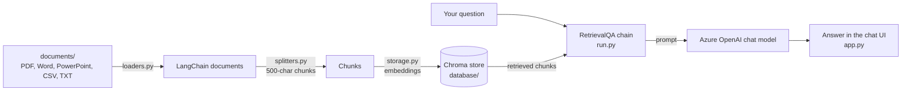

# DocGPT

Ask questions about your own documents using GPT models.

DocGPT reads the files in a folder, splits them into chunks, indexes the chunks in a local [Chroma](https://www.trychroma.com/) vector store, and answers questions with a [LangChain](https://github.com/langchain-ai/langchain) retrieval QA chain. You can use it through a Streamlit chat app or through the Jupyter notebooks in this repository.

> [!NOTE]
> DocGPT was built in mid-2023 against pinned library versions (LangChain 0.0.228, `openai` 0.27.8, Chroma 0.3.x, Streamlit 1.25). The setup below reproduces that environment; newer versions of these libraries are not compatible with the code as written.

## Contents

- [How it works](#how-it-works)
- [Supported file types](#supported-file-types)
- [Requirements](#requirements)
- [Installation](#installation)
- [Configuration](#configuration)
- [Usage](#usage)
- [Notebooks](#notebooks)
- [Project structure](#project-structure)
- [Known limitations](#known-limitations)
- [Troubleshooting](#troubleshooting)
- [License](#license)

## How it works



1. **Load** – every file in `DOCUMENTS_DIR` is opened with the LangChain loader that matches its extension (`docgpt/loaders.py`).
2. **Split** – documents are cut into chunks of up to 500 characters with a 50-character overlap using `RecursiveCharacterTextSplitter` (`docgpt/splitters.py`).
3. **Index** – any existing store in `VECTORSTORE_DB_DIR` is deleted and a new Chroma store is built from the chunks (`docgpt/storage.py`). Chunks are embedded with OpenAI embeddings when an API key is configured, otherwise with a local Hugging Face sentence-transformers model.
4. **Answer** – a `RetrievalQA` chain with the `"stuff"` strategy sends the retrieved chunks and your question to the chat model (temperature 0.7) and returns its answer (`docgpt/run.py`). The Streamlit app (`docgpt/app.py`) shows the conversation.

## Supported file types

| Extension | Loader | Notes |
| --- | --- | --- |
| `.pdf` | `PyMuPDFLoader` | One document per page. |
| `.docx` | `UnstructuredWordDocumentLoader` | |
| `.doc` | `UnstructuredWordDocumentLoader` | Requires [LibreOffice](https://www.libreoffice.org/) (`soffice` on your `PATH`) to convert the file first. |
| `.pptx` | `UnstructuredPowerPointLoader` | |
| `.csv` | `CSVLoader` | One document per row. |
| `.txt` | `TextLoader` | Read as UTF-8. |

Rules for the documents folder:

- Every entry in the folder must be a file with one of the extensions above, written in **lowercase** (`report.pdf`, not `report.PDF`). Any other entry stops loading with an error, including hidden files such as `.DS_Store`, files without an extension, and subfolders.
- Subfolders are not scanned.
- `documents/` is listed in `.gitignore`, so files you add there are not committed (the sample `documents/bitcoin.pdf` was committed before that rule was added).

## Requirements

- **Python 3.10.** The pinned dependencies include packages that don't install on Python 3.11 or later (for example `wrapt` 1.13.3, required by `argilla` 1.1.1).
- **A C++ compiler.** Chroma 0.3.x depends on `hnswlib`, which is only published as source and is compiled during installation: `build-essential` on Linux, Xcode Command Line Tools on macOS, or Microsoft C++ Build Tools on Windows.
- **An Azure OpenAI resource** (for the Streamlit app and the OpenAI notebooks) with:
  - a chat model deployment, for example GPT-4 32k;
  - an embeddings deployment named exactly **`text-embedding-ada-002`**. The code does not pass an embeddings deployment name, so LangChain falls back to this default.
- **Internet access on first run.** The `unstructured` library downloads NLTK data the first time it loads a Word or PowerPoint file, and the local-model notebook downloads its embeddings model from Hugging Face.
- Optional: **LibreOffice** to load `.doc` files, and a **GPT4All model file** for the local-model notebook (see [Notebooks](#notebooks)).

## Installation

```bash
git clone https://github.com/gitluis/docgpt.git
cd docgpt

# Create and activate a Python 3.10 environment
python3.10 -m venv .venv
source .venv/bin/activate            # Windows: .venv\Scripts\activate
```

`pip-requirements.txt` is a full freeze of the original development environment. It was captured on Windows and contains two pins that conflict with `streamlit==1.25.0`, so install it without those lines, and add Chroma at a version that supports the code's storage settings:

```bash
python -c "import re; open('requirements.local.txt', 'w').writelines(l for l in open('pip-requirements.txt') if not re.match(r'(pywin32|pywinpty|Pillow|tzlocal)==', l))"
pip install -r requirements.local.txt "chromadb==0.3.26"
```

The first command writes `requirements.local.txt`, a copy of `pip-requirements.txt` without the Windows-only `pywin32` and `pywinpty` pins and without the `Pillow` and `tzlocal` pins (pip then picks versions Streamlit accepts). You can delete the file once the install finishes.

Why `chromadb==0.3.26`: `conda-requirements.txt` lists `chromadb` without a version, but Chroma 0.4 and later dropped the `duckdb+parquet` storage the code uses, and the later 0.3.x releases (0.3.27 and 0.3.29) require an older FastAPI than the one pinned in `pip-requirements.txt`.

If you use conda, create the environment with `conda create -n docgpt python=3.10`, activate it, and run the same two commands.

## Configuration

Settings are read from a `.env` file with [python-dotenv](https://github.com/theskumar/python-dotenv). Start from the annotated template:

```bash
cp env-example.txt .env
```

Keep `.env` in the repository root. It is listed in `.gitignore`; never commit API keys.

### Streamlit app and OpenAI notebooks

Every `OPENAI_*` value below is passed straight to the `openai` client, so a missing or empty value causes an error. These names follow the Azure OpenAI setup the code was written for.

| Variable | Required | Description |
| --- | --- | --- |
| `DOCUMENTS_DIR` | Yes | Folder with the files to index, relative to where you start the app. Default in the template: `documents`. |
| `VECTORSTORE_DB_DIR` | Yes | Folder for the Chroma store. Default in the template: `database`. If it already contains a Chroma store, the **whole folder is deleted** and rebuilt on every run, so don't keep other files in it. |
| `OPENAI_API_TYPE` | Yes | `azure`. |
| `OPENAI_API_BASE` | Yes | Your resource endpoint, for example `https://<resource-name>.openai.azure.com/`. |
| `OPENAI_API_VERSION` | Yes | An Azure OpenAI REST API version your resource supports. |
| `OPENAI_API_KEY` | Yes | Your Azure OpenAI key. |
| `OPENAI_API_DEPLOYMENT_NAME` | Yes | Name of your chat model deployment. |
| `OPENAI_API_MODEL_NAME` | Yes | The model behind that deployment, for example `gpt-4-32k`. |
| `OPENAI_EMBEDDINGS_MODEL_NAME` | Yes | `text-embedding-ada-002`. Your embeddings deployment must have this same name (see [Requirements](#requirements)). |

Using OpenAI's public API instead of Azure OpenAI is not a tested configuration: requests are built Azure-style, with deployment names.

### Local-model notebook

| Variable | Description |
| --- | --- |
| `DOCUMENTS_DIR`, `VECTORSTORE_DB_DIR` | Same as above. |
| `LOCAL_MODEL_PATH` | Path to the GPT4All model file, for example `models/ggml-gpt4all-j-v1.3-groovy.bin`. `models/` is git-ignored. |
| `LOCAL_MODEL_TYPE` | Read by the notebook but not used; the notebook always loads the model with the GPT-J backend. |
| `EMBEDDINGS_MODEL_NAME` | Hugging Face sentence-transformers model used for embeddings, for example `all-MiniLM-L6-v2`. |
| `MODEL_MAX_TOKENS` | Maximum number of tokens the model generates (default 1000). |
| `MODEL_N_BATCH` | Number of prompt tokens processed per batch (default 20). |
| `TARGET_SOURCES` | Number of chunks retrieved to answer each question (default 5). |

### Settings in code

A few settings are constants in `docgpt/run.py` rather than environment variables: the chunk size (500 characters), the chunk overlap (10% of the chunk size), the chat model temperature (0.7), and the number of chunks retrieved per question (all of them).

## Usage

### Streamlit chat app

1. Put the files you want to query in `documents/` (or the folder set in `DOCUMENTS_DIR`).
2. From the **repository root**, run:

   ```bash
   streamlit run docgpt/app.py
   ```

3. Open the URL Streamlit prints (usually <http://localhost:8501>) and type a question in the chat box.

Run the command from the repository root: `DOCUMENTS_DIR` and `VECTORSTORE_DB_DIR` are resolved relative to the current directory.

> [!IMPORTANT]
> The contents of your documents are sent to your Azure OpenAI resource, both to create embeddings and as context for each answer.

### Build the index from the command line

```bash
python docgpt/run.py
```

This loads, splits, and indexes the documents into `VECTORSTORE_DB_DIR` and exits. It is useful for checking that your documents load and that the embeddings deployment works before starting the app.

### Scripted demo

`docgpt/FCC_Copilot.py` is a self-contained Streamlit demo that replays pre-recorded answers stored in `docgpt/messages.py`, with a typing effect. It makes no model calls and needs no `.env`. Only the exact questions stored in `messages.py` have answers; any other input raises a `KeyError`.

```bash
streamlit run docgpt/FCC_Copilot.py
```

## Notebooks

Start Jupyter from the repository root so that `from docgpt import ...` and the relative folders in `.env` resolve:

```bash
jupyter lab
```

| Notebook | What it does | Needs |
| --- | --- | --- |
| `Document Summarization & QA using OpenAI.ipynb` | Runs the same pipeline as the app step by step, then asks questions and summarization prompts with `ask_document(...)`. `interact(qa)` starts an interactive question loop. | Azure OpenAI variables |
| `Document Summarization & QA using OpenAI (PPT).ipynb` | The same pipeline with a longer set of example questions and summarization prompts. | Azure OpenAI variables |
| `Document Summarization & QA using Local LLM.ipynb` | Runs fully on your machine: sentence-transformers embeddings and a GPT4All-J model. The summarization cells are stored as raw (non-executable) cells; convert them to code cells to use them. `run_qa()` starts an interactive question loop; type `exit` to stop. | Local-model variables and model file |
| `ChatLLM with Documents.ipynb` | An earlier version of the local chat loop, kept for reference. It imports `load_documents` and `constants` modules that are no longer in the repository and reads older variable names (`PERSIST_DIRECTORY`, `MODEL_TYPE`, `MODEL_PATH`), so it doesn't run as-is. | — |

The notebooks are committed with the outputs of earlier runs.

For the local-model notebook, obtain the `ggml-gpt4all-j-v1.3-groovy.bin` model file and place it at `LOCAL_MODEL_PATH`. It is a GGML-format model that needs the pinned `gpt4all==1.0.3`; newer GPT4All releases expect GGUF model files.

## Project structure

```text
docgpt/
├── docgpt/
│   ├── app.py              # Streamlit chat app (entry point)
│   ├── run.py              # Builds the index and the RetrievalQA chain
│   ├── loaders.py          # Maps file extensions to LangChain document loaders
│   ├── splitters.py        # Splits documents into chunks
│   ├── storage.py          # Creates, checks, updates and removes the Chroma store
│   ├── FCC_Copilot.py      # Scripted Streamlit demo with pre-recorded answers
│   └── messages.py         # Pre-recorded questions and answers for the demo
├── documents/              # Your input files (git-ignored; contains a sample PDF)
├── *.ipynb                 # Exploration notebooks (see Notebooks)
├── env-example.txt         # Annotated template for .env
├── pip-requirements.txt    # Full pip freeze of the original environment
├── conda-requirements.txt  # Packages installed with conda (chromadb)
└── LICENSE
```

The `database/` and `models/` folders are created by you or by the app at runtime and are git-ignored.

## Known limitations

- **The index is rebuilt on every message.** Streamlit reruns `app.py` after each interaction, and `app.py` calls `run.main()` every time. Each question therefore reloads all documents, deletes and recreates the Chroma store, and re-embeds every chunk (one embeddings request per chunk) before the answer is generated. Expect slow responses and embeddings costs that grow with the size of your documents.
- **All chunks go into a single prompt.** The retriever returns every chunk (`k` equals the number of chunks) and the `"stuff"` chain places them all in one prompt, so the combined text of your documents must fit in the chat model's context window. The project was used with GPT-4 32k.
- **No conversation memory.** Each question is answered on its own; earlier messages in the chat are displayed but not sent to the model.
- **No source citations in the app.** The chain is built with `return_source_documents=False`, so answers don't show which documents they came from.
- **Pinned 2023 dependencies.** See the note at the top and [Installation](#installation).

## Troubleshooting

| Symptom | Cause and fix |
| --- | --- |
| `ResolutionImpossible` mentioning `Pillow`, `tzlocal`, or `streamlit` | Installing `pip-requirements.txt` directly. Use the filtered install in [Installation](#installation). |
| `No matching distribution found for pywin32` | Same as above: `pywin32` and `pywinpty` are Windows-only. |
| Build failure for `wrapt` mentioning `formatargspec` | You're on Python 3.11 or later. Use Python 3.10. |
| Build failure for `hnswlib` | No C++ compiler available. Install one (see [Requirements](#requirements)). |
| `ModuleNotFoundError: No module named 'chromadb'` | Chroma isn't in `pip-requirements.txt`. Run `pip install "chromadb==0.3.26"`. |
| Error about a deprecated Chroma configuration | Chroma 0.4 or later is installed. Run `pip install "chromadb==0.3.26"`. |
| `InvalidAPIType: The API type provided in invalid` | `OPENAI_API_TYPE` is empty or missing in `.env`. Set it to `azure`. |
| Error saying the deployment does not exist, during "Creating embeddings" | No Azure deployment named `text-embedding-ada-002`. Create one with that name. |
| `ValueError: Directory 'documents' does not exist!` | The app was started from another folder, or `DOCUMENTS_DIR` is wrong. Run from the repository root. |
| `ValueError: Document type '(...)' is not supported!` | The documents folder contains an unsupported file, a hidden file (such as `.DS_Store`), a file without an extension, or a subfolder. Remove it. |
| `KeyError: '.PDF'` (or another uppercase extension) | Rename the file with a lowercase extension. |
| `soffice command was not found` | Install LibreOffice to load `.doc` files, or save them as `.docx`. |
| Error about the maximum context length | Your documents are too large to fit in one prompt. Use fewer or smaller documents, or a chat deployment with a larger context window. |
| `KeyError` in `FCC_Copilot.py` | The demo only answers the exact questions stored in `docgpt/messages.py`. |

## License

Released under the [MIT License](LICENSE). Copyright (c) 2023 Luis Rivera.
